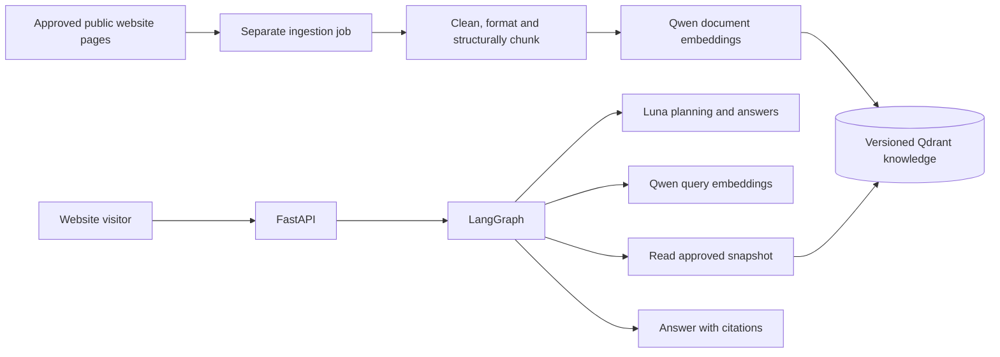

# Architecture and folder ownership

Status: M1 API/configuration shell, M2 provider adapters and M3 corpus preparation/embedding/unpublished candidate verification are implemented. M4 has evaluation-only retrieval and evidence assembly; M5 now has an initial offline LangGraph prototype. Serving retrieval, verified semantic planning/answer admission and active-index publication remain pending. Actual scoped evidence is in [PROJECT_STATUS.md](../PROJECT_STATUS.md).

## Stack

| Component | Choice and purpose |
| --- | --- |
| Runtime | Python 3.11.9 verified locally; manifest permits 3.11 through 3.13, with 3.12/3.13 untested |
| HTTP API | FastAPI with Pydantic request/response models |
| Orchestration | Pinned LangGraph 1.2.15 `StateGraph`; initial offline conditional workflow tested |
| Planning and answers | `openai/gpt-6-luna`, accessed through OpenRouter |
| Embeddings | `qwen/qwen3-embedding-8b`, hosted through OpenRouter by default |
| Knowledge store | Qdrant, cosine vectors plus source metadata |
| Packaging | Implemented `pyproject.toml` and `uv.lock`; dependencies verified through M1 tests |
| Deployment | Linux Docker image and Compose services |
| Verification | pytest with mocked network dependencies; Ruff |

Qdrant and hosted embedding delivery are design defaults. Hosting the 8B model locally would require a separate inference service and resource sizing; the initial deployment does not require a GPU.

## Directory layout

```text
clinic_agentic_rag/
  AGENTS.md                    Codex rules and continuity instruction
  PROJECT_STATUS.md            Current milestone and next action
  README.md                    Project entry point
  pyproject.toml               Package and tool configuration
  uv.lock                      Exact dependency resolution
  .python-version              Python 3.11 for local uv selection
  .env.example                 Planned configuration, no secrets
  .env                         Ignored local configuration
  .gitignore
  .gitattributes               Consistent source line endings
  .dockerignore
  docs/
    PROJECT_SPECIFICATION.md
    ARCHITECTURE.md
    PIPELINE.md
    INGESTION.md
    INGESTION_RUNBOOK.md
    PROVIDERS.md
    API_CONTRACT.md
    DEPLOYMENT.md
    EVALUATION.md
    IMPLEMENTATION_PLAN.md
    DECISIONS.md
    SOURCES.md
  src/telescope_rag/
    api/routes/                Chat and health endpoint adapters
    core/                      Settings, budgets, errors, safe logging
    graph/                     Closed contracts, source bindings, offline graph and nodes
    providers/                 Chat and embedding adapters
    ingestion/                 Discovery, collection, cleaning, indexing
    retrieval/                 Bounded read operations on approved knowledge
    knowledge/                 Evidence models, directory manifests, hours logic
    prompts/                   Versioned planner and answer prompts
  tests/
    unit/                      Pure logic and schema checks
    integration/               API/graph/provider contracts with fakes
    evaluation/                Bilingual source-backed evaluation fixtures
  scripts/                     Future evaluation helpers; ingestion has a package CLI
  deploy/                      Future Dockerfile, compose.yaml, proxy config
  data/
    raw/                       Ignored source snapshots
    processed/                 Ignored extracted documents and chunks
    manifests/                 Ignored snapshot/index audit manifests
```

Unimplemented directories retain `.gitkeep` files. Package metadata, lockfile, settings, schemas, middleware, health/chat routes, app factory, knowledge readiness interface, provider adapters, ingestion package/CLI and offline tests exist. A separate local Qdrant gateway Compose file exists; application Dockerfile/Compose packaging remains unimplemented.

The implemented app entry point is `telescope_rag.api.main:create_app` with Uvicorn's `--factory`. Importing the module does not read secrets or start clients. The lifecycle closes its injected knowledge adapter with a configurable shutdown deadline and fixed, content-free failure events. The default adapter makes no network request and cannot claim an approved index exists. Production requires a knowledge credential to be present, but actual read-only permission enforcement belongs to the live Qdrant implementation and deployment checks.

## Two execution paths

The [public-hours layer](PUBLIC_HOURS.md) now supplies source-bound reviewed schedule records and pure typed comparisons under `knowledge/`. It distinguishes facility/doctor owners, separate language claims, weekly/date scope and actual attendance, with explicit uncertainty for missing evidence and ambiguous clocks. Trusted callers must authenticate the review plan and exact catalog. It is not wired to question interpretation or public serving; the existing graph time operation remains unavailable pending its typed input contract.

The [offline response presenter](OFFLINE_RESPONSE.md) now projects actual graph runs into a closed plain-text/citation envelope through explicit `offline_response_format="rendered"` construction. Every question, status/reason, exact selected quotation and separate owner remains visible; source bindings are rechecked without semantic promotion, translation, another model call or prompt changes. The previous draft wire remains the default for injected services, and default/production serving remains unavailable. Live acceptance and the accepted public answer contract are still pending.

The [request-scoped dense bridge](REQUEST_RETRIEVAL_BRIDGE.md) now implements the injected retrieval contract using verified query formatting, optional exact read-only cache reuse and pinned candidate point filters before top-k. It shares the graph budget and never writes knowledge/cache data, creates a second ledger or interprets source ownership by similarity. Its HTTP-to-reader integration and cancellation/scope contracts are tested with mocked providers/database transport; an actual immutable corpus/tokenizer binding passes with dispatch forbidden. Production/default serving and source/index publication remain unavailable.

An explicit nonproduction [HTTP draft service](OFFLINE_SERVICE.md) now composes the existing offline graph with caller-injected chat/retrieval/catalog/counter/authority dependencies. `create_app` selects it only through a trusted Python argument; default chat remains unavailable and production configuration is refused. The boundary returns source-linked per-question drafts with offline/unverified flags, preserves request-owned budgets and keeps resources caller-owned. The actual HTTP/graph/provider adapter path is tested with synthetic data and mocked transport; live retrieval, model acceptance, accepted public answer generation and production composition remain pending. It performs no automatic credential loading, client creation, source approval or index publication.



The ingestion process can write candidate index versions. The chat process can read the active approved version only. Neither process integrates with patient databases or private calendars. Website forms and arbitrary user URLs are not executable graph tools.

## Ownership and dependencies

- API routes validate transport input and invoke a service; they do not contain prompts, crawl websites, or implement retrieval logic.
- Graph nodes coordinate typed state and transitions. Provider adapters and retrieval services are injected, allowing offline tests.
- Provider adapters own authentication, endpoint requests, output parsing, timeouts, and usage metadata. They expose narrow interfaces instead of leaking SDK responses through the application.
- Retrieval owns Qdrant reads, source filters, query-to-result mapping, and finite directory reads. It cannot create or switch collections through the public serving interface.
- Ingestion owns discovery policy, immutable raw snapshots, structural extraction, deterministic cleaning/formatting, variable-length chunk IDs, pre-embedding validation, embedding batches, candidate writes, and index manifests. A size ceiling is applied inside preserved structural/ownership boundaries, rather than flattening pages into fixed windows.
- Knowledge models preserve evidence ownership and implement pure operations such as comparing a requested time with an evidenced interval.
- Core owns validated settings. `providers/budget.py` implements the shared request budget/deadline; graph stages must use the same instance. Prompt files own model instructions; web content never changes them.

The provider package now contains narrow typed contracts, safe errors, strict JSON/schema/vector validation, request-owned reservations and content-free receipts, and an async HTTPX2 client with no hidden retries. It is independent of the FastAPI factory and makes no initialization/shutdown inference calls. [PROVIDERS.md](PROVIDERS.md) documents the live-use gates and external wire behavior.

Ingestion owns `collection.py` (robots/discovery and pinned GET transport), `models.py` (source/provenance records), `extraction.py`, `preparation.py`, `review.py` (digest-bound source review), `indexing.py` (gated embedding/cache/candidate writes), and `cli.py` (collect/prepare only). It uses Beautiful Soup and an explicit HTTPcore2 network backend. It cannot change an active index alias. [INGESTION_RUNBOOK.md](INGESTION_RUNBOOK.md) separates verified local behavior from remaining live-use gates.

Keep this as one Python application plus a separately invoked ingestion command. Additional queues, Redis, a session database, rerankers, and specialized agents are not initial dependencies. Add them only for a measured need.

The M4 comparison reader is explicitly supplied the complete pinned candidate point inventory and a read-only key. It allows only candidate-info/alias reads and exact query requests, bounds response bytes/time/results and rejects mismatched owner/payload metadata. `retrieval/lexical.py` provides the local BM25/RRF baseline, and `retrieval/query_vectors.py` provides an explicit query-only cached embedding stage with verified counts and receipts. `scripts/compare_retrieval.py` freezes parameters and writes separate experiment evidence. These modules do not change the default unavailable knowledge adapter, enable chat inference, infer query scope or interpret source uncertainties. Dense and hybrid remain measured candidates until the documented comparison/adoption gates pass.

`retrieval/assembly.py` now implements an offline candidate-assembly kernel over an exact-digest `EvidenceCatalog`. Explicit request parts retain original spans and excluded/clarification states. Exact owner/document/language filters precede grouping; per-part occurrence/citation bindings survive shared presentation. Complete scope reads derive membership from the supplied admitted bundle, with missing members reported. Round-robin packing counts the complete rendering, preserves full passages and reports omissions. Source flags restrict explicitly requested uses; unknown flags retain context only. These are metadata/structural checks, not semantic relevance, planner validation or factual-answer admission. Qwen counts are labeled retrieval-only; Luna admission remains false.

`retrieval/cached_dense.py` performs bounded local float64 cosine ranking of explicitly supplied cached vectors. Its caller can group exact evidence before result truncation and retain all occurrence IDs; it does not load credentials, embed text, query Qdrant or infer equivalence. `scripts/replay_evidence_assembly.py` isolates occurrence presentation, coalescing within an unchanged top 20 pool and grouping before selecting 20. Its raw-query probes do not implement conversation/decomposition; source/gold/input/cache bindings and all selected renderings are saved before scoring. Every cache file must match its original independently recorded hosted-run hash; historical review/configuration references are pinned. Local float64 ranks can differ from Qdrant's normalized float32 ranks. These offline components remain separate from the unavailable public chat adapter.

## State and persistence

The initial API accepts bounded conversation history and does not persist conversations on the server. Compile the graph without a durable conversation checkpointer for this phase. Preserve knowledge snapshots and ingestion manifests independently of chat state.

The implemented `graph/workflow.py` compiles an acyclic offline graph with no checkpointer/retry policy. Provider/retrieval/catalog dependencies stay on the service, while the per-run budget stays in runtime context outside state. The public API does not construct or call this graph. `graph/bindings.py` issues exact source handles and validates literal spans/history links; `graph/contracts.py` separates strict provider wire models from convenience assembly models. `prompts/offline_v1.py` defines planner and full-passage extractive-draft instructions. Every final part remains explicit, and candidate quotations have per-part source identity/provenance. Semantic interpretation, quote relevance, Luna compatibility and serving admission are still unverified; see [the implemented offline scope](PIPELINE.md#implemented-offline-prototype).

If server-side memory becomes necessary, define ownership, retention, deletion, and multi-worker behavior first. An arbitrary client-supplied conversation ID must never expose another visitor's messages.

## Grounding limitation

Source admission, citation validation, exact entity ownership, and deterministic time calculations reduce errors. Structural checks alone cannot prove that every free-text paraphrase is supported. Source-based bilingual evaluation and clinic review remain necessary before release.
