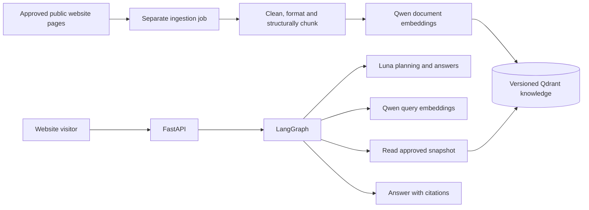

# Architecture and folder ownership

Status: the local MVP is implemented with a Docker API, browser UI, bounded
LangGraph planner/retrieval/writer flow and read-only access to the pinned reviewed
candidate. The default/production factory remains unavailable; no active alias is
published. Scoped live checks and remaining limitations are recorded in
[acceptance](LOCAL_MVP_ACCEPTANCE.md) and [current status](../PROJECT_STATUS.md).

## Stack

| Component | Choice and purpose |
| --- | --- |
| Runtime | Python 3.11.17 in the verified container; earlier host checks used 3.11.9. Manifest permits 3.11 through 3.13; 3.12/3.13 remain untested |
| HTTP API | FastAPI with Pydantic request/response models |
| Orchestration | Pinned LangGraph 1.2.15 `StateGraph`; bounded local conversational workflow |
| Planning and answers | `openai/gpt-6-luna`, accessed through OpenRouter |
| Embeddings | `qwen/qwen3-embedding-8b`, OpenRouter with the verified `deepinfra/us` route and 4,096 dimensions |
| Knowledge store | Qdrant, cosine vectors plus source metadata |
| Packaging | `pyproject.toml`, `uv.lock`, pinned Python/uv build images and locked runtime installation |
| Deployment | Local API Docker image, existing Qdrant and separate Nginx gateway; loopback host ports |
| Verification | pytest with mocked network dependencies; Ruff |

Luna and Qwen run remotely through OpenRouter. No model weights, local GPU inference
service or model container is part of this installation.

## Directory layout

```text
clinic_agentic_rag/
  AGENTS.md                    Codex rules and continuity instruction
  PROJECT_STATUS.md            Current milestone and next action
  README.md                    Project entry point
  pyproject.toml               Package and tool configuration
  uv.lock                      Exact dependency resolution
  .python-version              Python 3.11 for local uv selection
  .env.example                 General configuration template, no secrets
  .env                         Ignored local configuration
  .gitignore
  .gitattributes               Consistent source line endings
  .dockerignore
  docs/
    PROJECT_SPECIFICATION.md
    ARCHITECTURE.md
    PIPELINE.md
    INGESTION.md
    INGESTION_RUNBOOK.md
    PROVIDERS.md
    API_CONTRACT.md
    DEPLOYMENT.md
    EVALUATION.md
    IMPLEMENTATION_PLAN.md
    DECISIONS.md
    SOURCES.md
  src/telescope_rag/
    api/routes/                Chat and health endpoint adapters
    core/                      Settings, budgets, errors, safe logging
    graph/                     Closed contracts, source bindings, offline graph and nodes
    providers/                 Chat and embedding adapters
    ingestion/                 Discovery, collection, cleaning, indexing
    retrieval/                 Bounded read operations on approved knowledge
    knowledge/                 Evidence models, directory manifests, hours logic
    prompts/                   Versioned planner and answer prompts
  tests/
    unit/                      Pure logic and schema checks
    integration/               API/graph/provider contracts with fakes
    evaluation/                Bilingual source-backed evaluation fixtures
  scripts/                     Explicit preparation/evaluation/diagnostic helpers
  deploy/                      API Dockerfile, local API/gateway Compose and proxy config
  run-mvp.ps1                  Docker Start/Stop/Status/Restart
  run-local.ps1                Alternative host-Python API launcher
  data/
    raw/                       Ignored source snapshots
    processed/                 Ignored extracted documents and chunks
    manifests/                 Ignored snapshot/index audit manifests
```

The application, provider/ingestion/retrieval packages, graph, tests and local Docker
packaging exist. Data placeholders do not contain the reviewed corpus. Exact runtime
resources and keys are supplied outside Git and the API image; see
[GitHub and handoff](GITHUB_AND_HANDOFF.md).

The Docker entry point is `telescope_rag.api.container:create_container_app`, which
explicitly composes `api.local:create_local_app` with `/runtime` resources and file
secrets. `run-local.ps1` selects the host composition and project dotenv. The original
`api.main:create_app` remains the fail-closed default; a production setting is not a
switch that enables the local MVP. The application lifecycle owns and closes its
provider/database clients. Health checks validate local knowledge without inference.

## Two execution paths

**Offline ingestion:** allowlisted public pages become immutable snapshots, structured
chunks, reviewed admission metadata, counted embedding inputs and a separately
authorized candidate collection. It is not executed by chat or API startup.

**Local serving:** Luna plans bounded question parts against issued source handles.
Search parts use at most one Qwen query batch and scoped read-only Qdrant retrieval;
complete-source parts read the admitted catalog directly. The local search pool
retains dense hits with bounded literal and section-context additions. Already
requested/retrieved same-page candidates can be offered to another search part only
under that receiving part's exact scope and source policy. Global assembly caps and
separate per-part citation bindings remain enforced.

The [public-hours layer](PUBLIC_HOURS.md) computes supported time comparisons using
reviewed owner-bound records. The [second Luna stage](CONVERSATIONAL_ANSWERS.md)
writes conversational prose from the original question and supplied evidence,
including computed hours and separately proven [website links](PUBLIC_WEBSITE_LINKS.md).
Reference/scope checks precede presentation; source IDs remain in metadata/details,
while the visible answer uses readable prose/bullets and isolated numeric runs.

Normal local requests have two Luna stages and at most one query embedding batch,
one retrieval round and no automatic retry/fallback. The query cache is read-only;
new vectors stay request-local. Earlier injected [offline draft](OFFLINE_SERVICE.md)
and [extractive rendering](OFFLINE_RESPONSE.md) profiles retain their own contracts
and unverified flags; they are not the local conversational response wire.



The ingestion process can write candidate index versions under independent gates.
The current local chat reads one exact pinned candidate with the server-enforced
read key; it does not resolve a published active alias. No path accesses patient
databases or private calendars. Website forms and arbitrary user URLs are not tools.

## Ownership and dependencies

- API routes validate transport input and invoke a service; they do not contain prompts, crawl websites, or implement retrieval logic.
- Graph nodes coordinate typed state and transitions. Provider adapters and retrieval services are injected, allowing offline tests.
- Provider adapters own authentication, endpoint requests, output parsing, timeouts, and usage metadata. They expose narrow interfaces instead of leaking SDK responses through the application.
- Retrieval owns Qdrant reads, source filters, query-to-result mapping, and finite directory reads. It cannot create or switch collections through the public serving interface.
- Ingestion owns discovery policy, immutable raw snapshots, structural extraction, deterministic cleaning/formatting, variable-length chunk IDs, pre-embedding validation, embedding batches, candidate writes, and index manifests. A size ceiling is applied inside preserved structural/ownership boundaries, rather than flattening pages into fixed windows.
- Knowledge models preserve evidence ownership and implement pure operations such as comparing a requested time with an evidenced interval.
- Core owns validated settings. `providers/budget.py` implements the shared request budget/deadline; graph stages must use the same instance. Prompt files own model instructions; web content never changes them.

The provider package now contains narrow typed contracts, safe errors, strict JSON/schema/vector validation, request-owned reservations and content-free receipts, and an async HTTPX2 client with no hidden retries. It is independent of the FastAPI factory and makes no initialization/shutdown inference calls. [PROVIDERS.md](PROVIDERS.md) documents the live-use gates and external wire behavior.

Ingestion owns `collection.py` (robots/discovery and pinned GET transport), `models.py` (source/provenance records), `extraction.py`, `preparation.py`, `review.py` (digest-bound source review), `indexing.py` (gated embedding/cache/candidate writes), and `cli.py` (collect/prepare only). It uses Beautiful Soup and an explicit HTTPcore2 network backend. It cannot change an active index alias. [INGESTION_RUNBOOK.md](INGESTION_RUNBOOK.md) separates verified local behavior from remaining live-use gates.

Keep this as one Python application plus a separately invoked ingestion command. Additional queues, Redis, a session database, rerankers, and specialized agents are not initial dependencies. Add them only for a measured need.

The M4 comparison reader is explicitly supplied the complete pinned candidate point inventory and a read-only key. It allows only candidate-info/alias reads and exact query requests, bounds response bytes/time/results and rejects mismatched owner/payload metadata. `retrieval/lexical.py` provides the local BM25/RRF baseline, and `retrieval/query_vectors.py` provides an explicit query-only cached embedding stage with verified counts and receipts. `scripts/compare_retrieval.py` freezes parameters and writes separate experiment evidence. These modules do not change the default unavailable knowledge adapter, enable chat inference, infer query scope or interpret source uncertainties. Dense and hybrid remain measured candidates until the documented comparison/adoption gates pass.

`retrieval/assembly.py` now implements an offline candidate-assembly kernel over an exact-digest `EvidenceCatalog`. Explicit request parts retain original spans and excluded/clarification states. Exact owner/document/language filters precede grouping; per-part occurrence/citation bindings survive shared presentation. Complete scope reads derive membership from the supplied admitted bundle, with missing members reported. Round-robin packing counts the complete rendering, preserves full passages and reports omissions. Source flags restrict explicitly requested uses; unknown flags retain context only. These are metadata/structural checks, not semantic relevance, planner validation or factual-answer admission. Qwen counts are labeled retrieval-only; Luna admission remains false.

`retrieval/cached_dense.py` performs bounded local float64 cosine ranking of explicitly supplied cached vectors. Its caller can group exact evidence before result truncation and retain all occurrence IDs; it does not load credentials, embed text, query Qdrant or infer equivalence. `scripts/replay_evidence_assembly.py` isolates occurrence presentation, coalescing within an unchanged top 20 pool and grouping before selecting 20. Its raw-query probes do not implement conversation/decomposition; source/gold/input/cache bindings and all selected renderings are saved before scoring. Every cache file must match its original independently recorded hosted-run hash; historical review/configuration references are pinned. Local float64 ranks can differ from Qdrant's normalized float32 ranks. These offline components remain separate from the unavailable public chat adapter.

## State and persistence

The initial API accepts bounded conversation history and does not persist conversations on the server. Compile the graph without a durable conversation checkpointer for this phase. Preserve knowledge snapshots and ingestion manifests independently of chat state.

The base `graph/workflow.py` compiles an acyclic graph with no checkpointer/retry
policy. Local hours/conversational subclasses add the typed calculations and writer.
Dependencies stay on the service and the shared request budget stays outside graph
state in runtime context. `graph/bindings.py` validates issued source handles and
literal spans/history links. The local writer uses
`prompts/conversational_answer_v1.py`; `prompts/offline_v1.py` belongs to earlier
extractive profiles. Every original question part and citation owner remains explicit.
The browser sends independent requests with empty history; the API accepts bounded
caller-supplied history as interpretation context, never as factual evidence.

If server-side memory becomes necessary, define ownership, retention, deletion, and multi-worker behavior first. An arbitrary client-supplied conversation ID must never expose another visitor's messages.

## Grounding limitation

`graph/hours_workflow.py` supplies a separate nonproduction typed-hours variant.
A request-owned sidecar retains the clock, literal bindings and computed records;
it is not added to the old provider/source-draft wire. The hours presenter rebinds
those receipts and offered proof before rendering a versioned response. There is
no default plan/provider, environment toggle, parsing heuristic or persistence.
The local factory explicitly selects the supported variant; earlier injected
profiles remain separate. See [HOURS_GRAPH.md](HOURS_GRAPH.md) for component history.

Source admission, citation validation, exact entity ownership, and deterministic time calculations reduce errors. Structural checks alone cannot prove that every free-text paraphrase is supported. Source-based bilingual evaluation and clinic review remain necessary before release.
