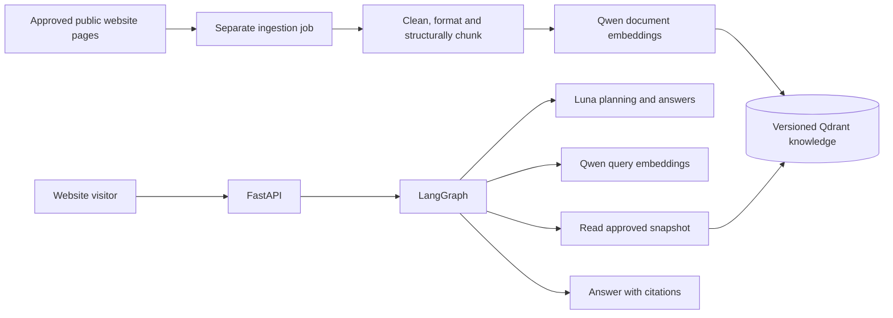

# Architecture and folder ownership

Status: M1 API/configuration shell implemented; provider, graph, ingestion, and live retrieval layers remain future work.

## Stack

| Component | Choice and purpose |
| --- | --- |
| Runtime | Python 3.11.9 verified locally; manifest permits 3.11 through 3.13, with 3.12/3.13 untested |
| HTTP API | FastAPI with Pydantic request/response models |
| Orchestration | LangGraph `StateGraph`, conditional edges, bounded shared state |
| Planning and answers | `openai/gpt-6-luna`, accessed through OpenRouter |
| Embeddings | `qwen/qwen3-embedding-8b`, hosted through OpenRouter by default |
| Knowledge store | Qdrant, cosine vectors plus source metadata |
| Packaging | Implemented `pyproject.toml` and `uv.lock`; dependencies verified through M1 tests |
| Deployment | Linux Docker image and Compose services |
| Verification | pytest with mocked network dependencies; Ruff |

Qdrant and hosted embedding delivery are design defaults. Hosting the 8B model locally would require a separate inference service and resource sizing; the initial deployment does not require a GPU.

## Directory layout

```text
clinic_agentic_rag/
  AGENTS.md                    Codex rules and continuity instruction
  PROJECT_STATUS.md            Current milestone and next action
  README.md                    Project entry point
  pyproject.toml               Package and tool configuration
  uv.lock                      Exact dependency resolution
  .python-version              Python 3.11 for local uv selection
  .env.example                 Planned configuration, no secrets
  .env                         Ignored local configuration
  .gitignore
  .gitattributes               Consistent source line endings
  .dockerignore
  docs/
    PROJECT_SPECIFICATION.md
    ARCHITECTURE.md
    PIPELINE.md
    INGESTION.md
    API_CONTRACT.md
    DEPLOYMENT.md
    EVALUATION.md
    IMPLEMENTATION_PLAN.md
    DECISIONS.md
    SOURCES.md
  src/telescope_rag/
    api/routes/                Chat and health endpoint adapters
    core/                      Settings, budgets, errors, safe logging
    graph/nodes/               State, graph assembly, node functions
    providers/                 Chat and embedding adapters
    ingestion/                 Discovery, collection, cleaning, indexing
    retrieval/                 Bounded read operations on approved knowledge
    knowledge/                 Evidence models, directory manifests, hours logic
    prompts/                   Versioned planner and answer prompts
  tests/
    unit/                      Pure logic and schema checks
    integration/               API/graph/provider contracts with fakes
    evaluation/                Bilingual source-backed evaluation fixtures
  scripts/                     Future ingestion and evaluation CLI entry points
  deploy/                      Future Dockerfile, compose.yaml, proxy config
  data/
    raw/                       Ignored source snapshots
    processed/                 Ignored extracted documents and chunks
    manifests/                 Ignored snapshot/index audit manifests
```

Unimplemented directories retain `.gitkeep` files. Package metadata, lockfile, settings, schemas, middleware, health/chat routes, app factory, knowledge readiness interface, and offline tests now exist. CLI ingestion scripts, Dockerfile, and Compose remain unimplemented.

The implemented app entry point is `telescope_rag.api.main:create_app` with Uvicorn's `--factory`. Importing the module does not read secrets or start clients. The lifecycle closes its injected knowledge adapter with a configurable shutdown deadline and fixed, content-free failure events. The default adapter makes no network request and cannot claim an approved index exists. Production requires a knowledge credential to be present, but actual read-only permission enforcement belongs to the live Qdrant implementation and deployment checks.

## Two execution paths



The ingestion process can write candidate index versions. The chat process can read the active approved version only. Neither process integrates with patient databases or private calendars. Website forms and arbitrary user URLs are not executable graph tools.

## Ownership and dependencies

- API routes validate transport input and invoke a service; they do not contain prompts, crawl websites, or implement retrieval logic.
- Graph nodes coordinate typed state and transitions. Provider adapters and retrieval services are injected, allowing offline tests.
- Provider adapters own authentication, endpoint requests, output parsing, timeouts, and usage metadata. They expose narrow interfaces instead of leaking SDK responses through the application.
- Retrieval owns Qdrant reads, source filters, query-to-result mapping, and finite directory reads. It cannot create or switch collections through the public serving interface.
- Ingestion owns discovery policy, immutable raw snapshots, structural extraction, deterministic cleaning/formatting, variable-length chunk IDs, pre-embedding validation, embedding batches, candidate writes, and index manifests. A size ceiling is applied inside preserved structural/ownership boundaries, rather than flattening pages into fixed windows.
- Knowledge models preserve evidence ownership and implement pure operations such as comparing a requested time with an evidenced interval.
- Core owns validated settings and a shared request budget/deadline. Prompt files own model instructions; web content never changes them.

Keep this as one Python application plus a separately invoked ingestion command. Additional queues, Redis, a session database, rerankers, and specialized agents are not initial dependencies. Add them only for a measured need.

## State and persistence

The initial API accepts bounded conversation history and does not persist conversations on the server. Compile the graph without a durable conversation checkpointer for this phase. Preserve knowledge snapshots and ingestion manifests independently of chat state.

If server-side memory becomes necessary, define ownership, retention, deletion, and multi-worker behavior first. An arbitrary client-supplied conversation ID must never expose another visitor's messages.

## Grounding limitation

Source admission, citation validation, exact entity ownership, and deterministic time calculations reduce errors. Structural checks alone cannot prove that every free-text paraphrase is supported. Source-based bilingual evaluation and clinic review remain necessary before release.
