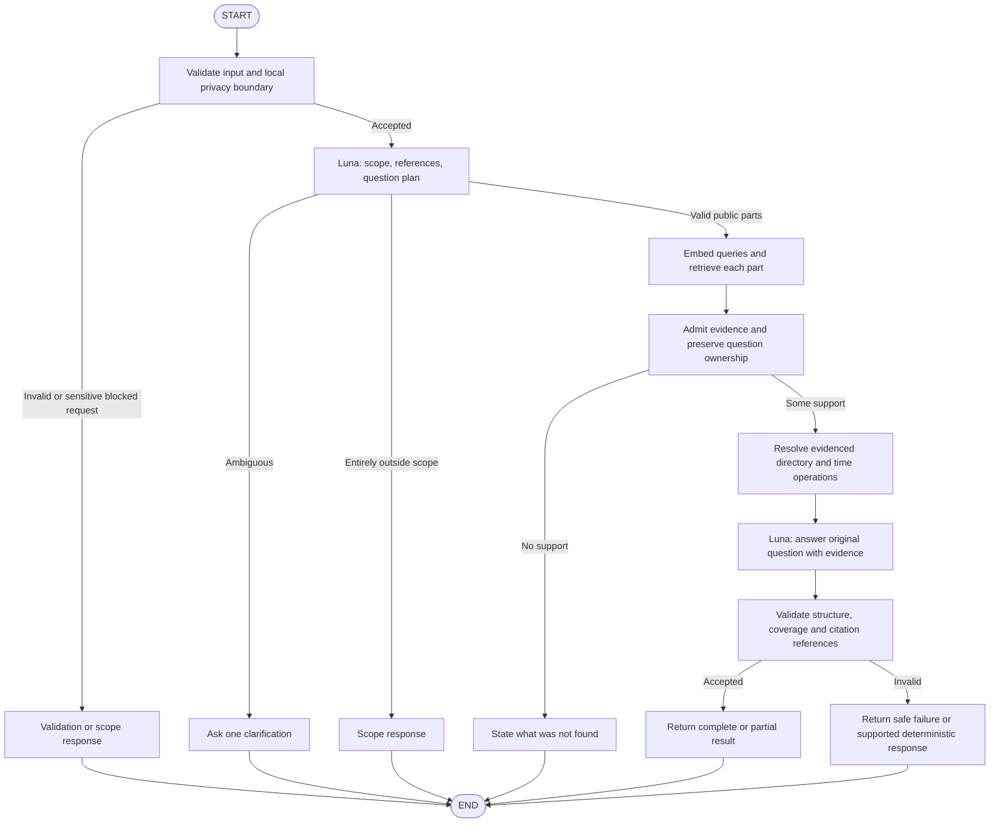

# LangGraph pipeline

Status: an initial offline LangGraph prototype is implemented and tested on 2026-10-16. Live Luna execution, semantic admission, serving retrieval, time calculations and API integration remain pending. The serving graph below remains the target design.

LangGraph can express both fixed workflows and dynamic agents. This MVP is a bounded adaptive RAG workflow: Luna plans the questions and the graph chooses answer, partial-answer, clarification, or refusal paths. It is not an unrestricted tool-selection loop. See [LangGraph's workflow and agent guide](https://docs.langchain.com/oss/python/langgraph/workflows-agents).

## Ingestion, before serving

```text
Approved public pages -> collect snapshots -> parse source structure
  -> clean -> normalize and format typed blocks with provenance
  -> form variable-length chunks by format and ownership -> validate inputs
  -> Qwen document embeddings -> candidate Qdrant collection
  -> validate coverage and sources -> publish approved snapshot
```

Document embeddings are computed once per changed content/configuration, not on every chat request. The online pipeline embeds only the retrieval queries.

Clean and format before document embedding. Retain doctor profiles, FAQ pairs, section hierarchies, lists, table headers/rows, and time qualifiers as meaningful units. Token counts provide a safety ceiling; they do not dictate default boundaries. See [INGESTION.md](INGESTION.md) for the format-specific policy, oversized-unit handling, and pre-embedding validation gate.

## Implemented offline prototype

[OfflineRagWorkflow](../src/telescope_rag/graph/workflow.py) uses pinned `langgraph==1.2.15` and an acyclic `StateGraph` with explicit conditional edges:

```text
validate_request -> plan_query -> validate_plan
  -> retrieve_evidence -> assemble_evidence -> generate_draft -> validate_draft -> END
  -> finalize_safe -> END (excluded, clarification, unavailable operation or no eligible evidence)
```

The safe branch can follow plan validation or assembly. There is no graph retry/repair loop, durable checkpointer, streaming interface or default live dependency. One request-owned `ExecutionBudget` stays in runtime context outside serializable state and is shared with injected chat/retrieval services. The wrapper disables inherited LangSmith tracing and accepts no caller `RunnableConfig` or callbacks. Its deadline covers async stages; cancellation propagates. Assembly runs in a bounded worker: cancelling the await cannot forcibly terminate a counter already running in that thread.

The [closed planner and draft schemas](../src/telescope_rag/graph/contracts.py) have required nullable properties and forbid extras. The app issues part IDs after validating original character-span coverage, literal history links and source handles. The planner receives the unchanged question/history and a bounded server manifest; source handles are resolved only against the supplied pinned catalog. These literal/schema checks do not establish that the proposed semantic decomposition or intended use is correct. Tests use authored synthetic plans; natural-language Luna planning is unverified.

Search parts use one injected batch retrieval interface with exact snapshot/digest/part membership checks. Dense remains the provisional algorithm for later real adapter integration; graph tests use fakes, not live Qdrant or a newly connected dense/embedding service. `read_source` parts read exact complete admitted membership through `EvidenceCatalog`, without arbitrary URL fetching or a search call. Source restrictions apply to declared intended uses and per-part occurrence subsets. Time comparisons currently return `operation_unavailable`, preserving public siblings.

[Versioned offline prompts](../src/telescope_rag/prompts/offline_v1.py) ask for review-only extractive drafts. Each candidate quotation must equal the complete source `retrieval_text`; shortened qualifiers, invented IDs, hidden sidecar occurrences and sibling citations fail validation. Only the per-part citation IDs actually offered in the counted rendering are accepted; all other exact occurrences remain provenance. A complete-source candidate draft must reference every eligible rendered group. Coverage and source identity are checked, but relevance/entailment remain unverified.

Outputs use `draft_ready`, `not_found`, `out_of_scope`, `clarification_required` or `failed`, with each original part explicit. They never use `answered` or declare supported clinical claims. `offline_only=true`, `semantic_grounding_verified=false` and `luna_compatibility_verified=false` remain mandatory. The full provenance sidecar, stage events and content-free budget receipts accompany the offline result. Construction refuses production settings. Trusted injected services retain their own capabilities; dependency injection alone does not prove an arbitrary service is offline.

The normal path has one planning and one draft logical chat stage; all-nonpublic/no-eligible-evidence paths stop earlier. The existing provider counter must count the complete messages/schema/history/render/metadata for each dispatch; the assembler's Qwen count is only a retrieval-render ceiling. No synthetic count authorizes Luna. FastAPI still returns `503`; mock successes do not enable chat or establish production readiness.

## Planned serving request graph



## Node contracts

| Node | Input, responsibility, and result |
| --- | --- |
| `validate_request` | Enforce text/history limits and deadlines; reject unsupported payloads; apply conservative local privacy checks before external calls. |
| `plan_query` | One Luna structured-output call returns language, scope for each part, standalone questions, preserved entity/time constraints, ambiguities, and operation hints. |
| `retrieve_evidence` | Batch-embed eligible queries with Qwen. Read bounded candidates for each question from one pinned approved snapshot. Preserve query IDs and source ownership. |
| `admit_evidence` | Reject disallowed sources, stale time-sensitive data, mismatched identities, or unrelated sections. Mark parts supported, unresolved, conflicting, or excluded. Retrieval similarity alone is not support. |
| `resolve_operations` | For exhaustive listings, read the bounded approved directory manifest. For opening-hour comparisons, compute from evidenced structured intervals; retain source IDs. |
| `generate_answer` | Second Luna call receives the original question, bounded context, all planned parts, admitted evidence, computed results, and missing/excluded parts. Return structured answers and source IDs. |
| `validate_response` | Validate fields, source IDs, supplied quotations where used, citation URLs, question coverage, budgets, and outcome consistency. Render only validated references. |

No separate complexity classifier is needed: a simple question produces one planned question; a compound request produces several. The planner must not answer clinic facts from its own knowledge.

## Planning and decomposition

Each subquestion has an application-issued ID, original request span, standalone retrieval text, explicit entity constraints, scope, requested operation, and ambiguity information. Validate Luna's output with Pydantic and retain the original question unchanged.

Resolve pronouns from supplied context only when the identity is clear. Do not use fuzzy name matching to silently choose between doctors. Preserve comparisons and dependencies: "Which of these doctors performs X?" needs evidence connecting the stated doctors to X, not a generic services page.

If a request cannot fit four subquestions without losing meaning, ask the visitor to narrow it. Never truncate the question list and claim a full answer. Mixed public/private questions may continue with public parts while the excluded parts remain explicit.

## Retrieval and evidence assembly

Use cosine similarity over Qwen vectors, bounded per-question reads, and metadata filtering where the source establishes an identity. Merge repeat hits by chunk ID, then collapse exact repeated formatted evidence within the same literal owner/language/configuration while retaining every source occurrence, citation and question-to-evidence relationship. Shared footer or responsive copies must not consume multiple answer-context slots. Do not merge near matches or let a sibling question's doctor or treatment attribution migrate into another question. This retrieval behavior is M4 work, not implemented by the draft embedding-input manifest.

A complete directory listing uses its validated manifest, not just top-k vector hits. Retrieval can suggest relevant material; completeness and doctor ownership come from the source snapshot and its manifest. Do not claim that absent retrieved evidence proves the website contains no answer.

No paid reranker, query-rewrite retry, or extra answer judge is part of the initial flow. Diagnose observed recall failures through evaluation before adding these dependencies.

The initial offline assembly contract is now implemented in [assembly.py](../src/telescope_rag/retrieval/assembly.py). It accepts already-authored parts and exact admitted source scopes; it does not parse a question or authenticate a caller's intended-use classification. Every original non-whitespace character must belong to a retained request span. Source limitations apply to explicit uses, and output remains candidate evidence with semantic support unassessed. Exact coalescing preserves all occurrence records and per-part source subsets. Full admitted-source membership is separately reported from answer completeness or full-website coverage. Only the returned, fully counted rendering is within its Qwen retrieval budget; serializing its larger provenance sidecar for a model would require a new complete count. The planned online graph, semantic admission and Luna counting are still unimplemented.

## Opening-hours calculations

Clinic hours and public doctor working hours are separate facts. Use `Asia/Amman`; keep UTC timestamps for collection metadata. Use the server clock for "now," not a model's guessed current time.

An admitted hours record contains the source URL/span, applicable clinic or doctor identity, weekday or explicit date, intervals, timezone, publication qualifiers, and any evidenced exceptions. Missing hours are `unknown`, not `closed`. "Friday closed" requires explicit evidence.

When an interval is unambiguous, evaluate `open <= requested_time < close`. Model split shifts and overnight intervals explicitly. An ambiguous "7" requires AM/PM clarification when the answer changes. Explicit dated exceptions take precedence over general weekly hours; do not fabricate holiday exceptions. For date-specific questions, describe what posted general hours establish and whether exceptions are known.

Attribute answers to posted hours, with the snapshot date. Posted hours do not prove actual attendance, that the doors are currently open, or that appointments are available.

## Planned graph state

Store `request_id`, `original_query`, bounded `history`, `language`, validated `subquestions`, `scope_decisions`, `ambiguities`, pinned `snapshot_id`, `evidence_by_question`, `computed_results`, `unresolved_questions`, `draft_answer`, validated `citations`, `outcome`, `usage`, and `deadline`.

Graph state excludes keys, provider client objects, private records, hidden reasoning, and persistent user identifiers. Do not log state wholesale.

## Initial budgets

| Bound | Design default |
| --- | --- |
| Query | 4,000 characters |
| History | Six messages, 8,000 total characters; trim old context before token reservation |
| Subquestions | Four maximum; preserve all accepted request parts |
| Luna stages | Two: planning and generation |
| Retrieval rounds | One |
| Query embeddings | One bounded batch, at most four eligible questions |
| Candidate chunks | Five per question |
| Final evidence | At most 16 chunks and 6,000 tokens |
| Cumulative Luna input | 16,000 tokens including prompts, history, original question, and evidence |
| Cumulative output | 2,000 provider output tokens, including reasoning where billed/reported |
| Embedding input | 16,000 tokens across attempts, separately accounted from Luna input |
| Embedding batch | One logical batch of at most 32 texts; graph queries remain bounded to four |
| Overall request deadline | 30 seconds |
| Provider attempt timeout | At most 15 seconds and never beyond remaining deadline |
| Transient retries | At most one per provider operation, only within remaining budgets |

`MAX_LLM_CALLS=2` counts logical stages. A transport retry can add a physical request: at most four Luna attempts and two embedding attempts, including retries. Reserve tokens for every attempt; retries do not bypass cumulative limits. Do not retry a potentially billed ambiguous timeout automatically. Schema-invalid output has no extra LLM repair stage in this phase.

Use provider-compatible token accounting and fail conservatively if the tokenizer/count is uncertain. Oversized evidence or history must not displace the current question or silently erase unresolved parts. If sufficient context cannot fit, return clarification or an explicit partial/unknown result. These defaults need evaluation; they are not measured latency or cost guarantees.

M2 implements the provider budget/validation boundary in [PROVIDERS.md](PROVIDERS.md). Share one budget across graph stages; initialization is not permission to infer. Default counting refuses dispatch until a verified compatible profile is supplied, and embedding formatting must be explicitly verified/versioned. Unknown usage retains full attempt reservations; client attempt receipts do not establish hidden upstream activity.

Citation/schema validation does not establish semantic entailment of arbitrary generated prose. See [EVALUATION.md](EVALUATION.md) for the source-grounding review requirement.
